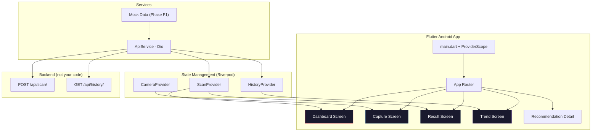

# 📱 Twacha — Frontend Implementation Plan (Android Only)

> **Owner:** Frontend / Flutter Person  
> **Stack:** Flutter · Riverpod · Dio · fl_chart · google_mlkit_face_detection  
> **Target:** Android Only  
> **Parallel with:** Backend plan (Django/Python) — coordinate on the API contract in Phase 1

---

## Table of Contents

1. [Architecture Overview (Frontend Only)](#1-architecture-overview-frontend-only)
2. [Everything to Download & Install](#2-everything-to-download--install)
3. [Phase F0 — Environment & Project Setup (Week 0)](#3-phase-f0--environment--project-setup-week-0)
4. [Phase F1 — API Contract & Mock Data Layer (Weeks 1–2)](#4-phase-f1--api-contract--mock-data-layer-weeks-1-2)
5. [Phase F2 — Design System & Theme (Week 1)](#5-phase-f2--design-system--theme-week-1)
6. [Phase F3 — Core Screens (Weeks 2–4)](#6-phase-f3--core-screens-weeks-2-4)
7. [Phase F4 — Camera & Face Alignment (Week 3)](#7-phase-f4--camera--face-alignment-week-3)
8. [Phase F5 — Swap Mock Data for Real API (Weeks 5–6)](#8-phase-f5--swap-mock-data-for-real-api-weeks-5-6)
9. [Phase F6 — Polish, Animations & Compliance (Weeks 6–7)](#9-phase-f6--polish-animations--compliance-weeks-6-7)
10. [Phase F7 — Build & Distribution (Week 8)](#10-phase-f7--build--distribution-week-8)
11. [Complete Frontend Folder Structure](#11-complete-frontend-folder-structure)
12. [Coordination Points with Backend](#12-coordination-points-with-backend)

---

## 1. Architecture Overview (Frontend Only)



### Screen Map

| Screen | Purpose | Data Source |
|---|---|---|
| **Dashboard** | Today's scores (gauges) + top recommendations + AQI badge | Latest `POST /scan/` response |
| **Capture** | Camera with face alignment oval overlay | Device camera |
| **Result** | Scores just returned + evidence-tagged recommendations | `POST /scan/` response |
| **Trend / History** | 7/14/30-day line charts, scrollable timeline, milestone markers | `GET /history/` |
| **Recommendation Detail** | Full explanation + citation per recommendation | From recommendation list |

### Key Design Principles

- **Gauge-style score display** — not plain progress bars
- **Evidence-tier color coding** on every recommendation card (green/amber/purple)
- **"Not a medical diagnosis" disclaimer** always visible near scores
- **Dark, premium aesthetic** — skin-health apps should feel trustworthy
- **Build against mock data first** — never wait for the backend

---

## 2. Everything to Download & Install

### 2.1 System-Level Prerequisites

| Tool | Version | Download Link | Purpose |
|---|---|---|---|
| **Flutter SDK** | 3.x (stable) | [flutter.dev/docs/get-started/install](https://flutter.dev/docs/get-started/install) | App framework |
| **Android Studio** | Latest | [developer.android.com/studio](https://developer.android.com/studio) | Android SDK + emulator |
| **VS Code** | Latest | [code.visualstudio.com](https://code.visualstudio.com/) | Editor (with Flutter extension) |
| **Git** | Latest | [git-scm.com/downloads](https://git-scm.com/downloads) | Version control |

### 2.2 Flutter Packages

Add to `pubspec.yaml` under `dependencies`:

```yaml
dependencies:
  flutter:
    sdk: flutter

  # ─── State Management ───
  flutter_riverpod: ^2.4.0
  riverpod_annotation: ^2.3.0

  # ─── Camera & Image ───
  camera: ^0.11.0
  image_picker: ^1.0.0

  # ─── Networking ───
  dio: ^5.4.0

  # ─── Charts ───
  fl_chart: ^0.68.0

  # ─── Face Detection (for camera overlay) ───
  google_mlkit_face_detection: ^0.12.0

  # ─── UI Components ───
  percent_indicator: ^4.2.0           # Circular gauge scores
  google_fonts: ^6.1.0               # Premium typography (Inter, Outfit)
  flutter_svg: ^2.0.0                # SVG icons
  shimmer: ^3.0.0                    # Loading skeleton animations
  lottie: ^3.0.0                     # Micro-animations
  flutter_animate: ^4.3.0            # Easy animation chains

  # ─── Local Storage ───
  shared_preferences: ^2.2.0         # Settings (photo retention toggle)
  flutter_secure_storage: ^9.0.0     # Secure token storage

  # ─── Permissions ───
  permission_handler: ^11.0.0        # Camera, location permissions

  # ─── Utilities ───
  intl: ^0.19.0                      # Date formatting
  path_provider: ^2.1.0              # File paths
```

Install:
```bash
flutter pub get
```

---

## 3. Phase F0 — Environment & Project Setup (Week 0)

> **Goal:** Flutter project running on an Android emulator or device with a blank scaffold.

### Step-by-Step

```bash
# ═══════════════════════════════════════════
# 1. VERIFY FLUTTER INSTALLATION
# ═══════════════════════════════════════════
flutter doctor
# Fix any issues shown (Android SDK, etc.)

# ═══════════════════════════════════════════
# 2. CREATE PROJECT
# ═══════════════════════════════════════════
cd twacha
flutter create --org com.twacha --platforms android --project-name twacha_app frontend
cd frontend

# ═══════════════════════════════════════════
# 3. ADD ALL PACKAGES (copy from §2.2 into pubspec.yaml)
# ═══════════════════════════════════════════
flutter pub get

# ═══════════════════════════════════════════
# 4. CREATE FOLDER STRUCTURE
# ═══════════════════════════════════════════
mkdir lib\screens
mkdir lib\widgets
mkdir lib\providers
mkdir lib\services
mkdir lib\models
mkdir lib\theme
mkdir lib\utils

# ═══════════════════════════════════════════
# 5. CONFIGURE ANDROID PERMISSIONS
# ═══════════════════════════════════════════
# Edit android/app/src/main/AndroidManifest.xml
```

### Android Permissions

```xml
<!-- android/app/src/main/AndroidManifest.xml -->
<manifest xmlns:android="http://schemas.android.com/apk/res/android">
    
    <!-- Camera for skin scanning -->
    <uses-permission android:name="android.permission.CAMERA" />
    <uses-feature android:name="android.hardware.camera" android:required="true" />
    <uses-feature android:name="android.hardware.camera.autofocus" android:required="false" />
    
    <!-- Internet for API calls -->
    <uses-permission android:name="android.permission.INTERNET" />
    
    <!-- Location (city-level only, for AQI) -->
    <uses-permission android:name="android.permission.ACCESS_COARSE_LOCATION" />
    <!-- Do NOT add ACCESS_FINE_LOCATION — city-level is all AQI needs -->

    <application
        android:label="Twacha"
        ...
    >
```

### Set Minimum Android SDK

```groovy
// android/app/build.gradle
android {
    defaultConfig {
        minSdkVersion 24  // Required for google_mlkit and camera
    }
}
```

### Verify Setup

```bash
flutter run
# Should show the default Flutter counter app on your Android emulator/device
```

---

## 4. Phase F1 — API Contract & Mock Data Layer (Weeks 1–2)

> **Goal:** Define data models matching the backend's JSON shapes. Build a mock data layer so you can develop all screens without waiting.

> [!IMPORTANT]
> **Do this together with the backend person.** Both sides must agree on JSON shapes before building anything else.

### 4.1 Data Models

```dart
// lib/models/scan_result.dart

class ScanResult {
  final int id;
  final DateTime createdAt;
  final double acneScore;
  final double rednessScore;
  final double drynessScore;
  final int? localAqi;
  final double? pm25;
  final String? dominantPollutant;
  final String? aqiBand;

  ScanResult({
    required this.id,
    required this.createdAt,
    required this.acneScore,
    required this.rednessScore,
    required this.drynessScore,
    this.localAqi,
    this.pm25,
    this.dominantPollutant,
    this.aqiBand,
  });

  factory ScanResult.fromJson(Map<String, dynamic> json) {
    return ScanResult(
      id: json['id'],
      createdAt: DateTime.parse(json['created_at']),
      acneScore: (json['acne_score'] as num).toDouble(),
      rednessScore: (json['redness_score'] as num).toDouble(),
      drynessScore: (json['dryness_score'] as num).toDouble(),
      localAqi: json['local_aqi'],
      pm25: json['pm25']?.toDouble(),
      dominantPollutant: json['dominant_pollutant'],
      aqiBand: json['aqi_band'],
    );
  }
}
```

```dart
// lib/models/recommendation.dart

class Recommendation {
  final String title;
  final String body;
  final String evidenceTier; // 'clinical', 'mixed', 'traditional'
  final String sourceNote;
  final String? trend;       // 'improving', 'flat', 'worsening', or null
  final Map<String, dynamic>? foodSuggestions;

  Recommendation({
    required this.title,
    required this.body,
    required this.evidenceTier,
    required this.sourceNote,
    this.trend,
    this.foodSuggestions,
  });

  factory Recommendation.fromJson(Map<String, dynamic> json) {
    return Recommendation(
      title: json['title'],
      body: json['body'],
      evidenceTier: json['evidence_tier'],
      sourceNote: json['source_note'],
      trend: json['trend'],
      foodSuggestions: json['food_suggestions'],
    );
  }
}
```

```dart
// lib/models/scan_response.dart

import 'scan_result.dart';
import 'recommendation.dart';

class ScanResponse {
  final ScanResult scan;
  final List<Recommendation> recommendations;

  ScanResponse({required this.scan, required this.recommendations});

  factory ScanResponse.fromJson(Map<String, dynamic> json) {
    return ScanResponse(
      scan: ScanResult.fromJson(json['scan']),
      recommendations: (json['recommendations'] as List)
          .map((r) => Recommendation.fromJson(r))
          .toList(),
    );
  }
}
```

### 4.2 API Service (with Mock Fallback)

```dart
// lib/services/api_service.dart

import 'dart:io';
import 'dart:math';
import 'package:dio/dio.dart';
import '../models/scan_result.dart';
import '../models/recommendation.dart';
import '../models/scan_response.dart';

class ApiService {
  // ─── CHANGE THIS when backend is deployed ───
  static const String _baseUrl = 'http://10.0.2.2:8000/api/'; // Android emulator → localhost
  // Use 'http://YOUR_LOCAL_IP:8000/api/' for physical device
  
  static const bool _useMockData = true; // ← SET TO FALSE in Phase F5

  final Dio _dio = Dio(BaseOptions(
    baseUrl: _baseUrl,
    connectTimeout: const Duration(seconds: 30),
    receiveTimeout: const Duration(seconds: 60), // CV processing takes time
    headers: {'Accept': 'application/json'},
  ));

  // ─── SCAN ───
  Future<ScanResponse> submitScan(File imageFile, {String city = 'Delhi'}) async {
    if (_useMockData) return _mockScanResponse();

    final formData = FormData.fromMap({
      'image': await MultipartFile.fromFile(imageFile.path),
      'city': city,
    });

    final response = await _dio.post('scan/', data: formData);
    return ScanResponse.fromJson(response.data);
  }

  // ─── HISTORY ───
  Future<List<ScanResult>> getHistory() async {
    if (_useMockData) return _mockHistory();

    final response = await _dio.get('history/');
    return (response.data as List)
        .map((json) => ScanResult.fromJson(json))
        .toList();
  }

  // ═══════════════════════════════════════════
  // MOCK DATA — Remove after Phase F5
  // ═══════════════════════════════════════════
  final _random = Random();

  ScanResponse _mockScanResponse() {
    return ScanResponse(
      scan: ScanResult(
        id: _random.nextInt(1000),
        createdAt: DateTime.now(),
        acneScore: 2.0 + _random.nextDouble() * 6.0,
        rednessScore: 1.0 + _random.nextDouble() * 5.0,
        drynessScore: 1.0 + _random.nextDouble() * 4.0,
        localAqi: 50 + _random.nextInt(250),
        pm25: 20.0 + _random.nextDouble() * 130.0,
        dominantPollutant: 'pm25',
        aqiBand: 'moderate',
      ),
      recommendations: [
        Recommendation(
          title: 'Reduce high-glycemic foods',
          body: 'Clinical evidence shows low-GI diets reduce acne lesion count by ~30%. Replace white rice with brown rice, maida with atta.',
          evidenceTier: 'clinical',
          sourceNote: 'Smith et al., 2007 — Am J Clin Nutr',
          trend: null,
          foodSuggestions: {
            'eat_more': ['brown rice', 'bajra roti', 'moong dal'],
            'eat_less': ['white rice', 'maida products', 'sugary drinks'],
          },
        ),
        Recommendation(
          title: 'Consider reducing dairy intake',
          body: 'Literature is mixed on dairy and acne. If prone to breakouts, try reducing milk-based products for 2-3 weeks.',
          evidenceTier: 'mixed',
          sourceNote: 'Adebamowo et al., 2005 — J Am Acad Dermatol',
          trend: 'improving',
          foodSuggestions: {
            'eat_more': ['almond milk', 'soy paneer'],
            'eat_less': ['whole milk', 'ice cream'],
          },
        ),
        Recommendation(
          title: 'Include turmeric in your diet',
          body: 'Turmeric (curcumin) has anti-inflammatory properties. Traditional Indian medicine supports its role in skin health.',
          evidenceTier: 'traditional',
          sourceNote: 'Vaughn et al., 2016 — Phytother Res',
          trend: null,
          foodSuggestions: {
            'eat_more': ['haldi doodh', 'turmeric in dal/sabzi'],
            'eat_less': [],
          },
        ),
      ],
    );
  }

  List<ScanResult> _mockHistory() {
    return List.generate(14, (i) {
      final day = DateTime.now().subtract(Duration(days: i * 2));
      return ScanResult(
        id: i + 1,
        createdAt: day,
        acneScore: 5.0 - (i * 0.2) + _random.nextDouble(),
        rednessScore: 3.5 - (i * 0.1) + _random.nextDouble() * 0.5,
        drynessScore: 2.5 + _random.nextDouble() * 0.5,
        localAqi: 100 + _random.nextInt(150),
        pm25: 50.0 + _random.nextDouble() * 80.0,
        dominantPollutant: 'pm25',
        aqiBand: 'moderate',
      );
    });
  }
}
```

### 4.3 Riverpod Providers

```dart
// lib/providers/scan_provider.dart

import 'dart:io';
import 'package:flutter_riverpod/flutter_riverpod.dart';
import '../services/api_service.dart';
import '../models/scan_response.dart';

final apiServiceProvider = Provider((ref) => ApiService());

final scanResultProvider = StateProvider<ScanResponse?>((ref) => null);
final isLoadingProvider = StateProvider<bool>((ref) => false);

final submitScanProvider = Provider((ref) {
  return (File imageFile, {String city = 'Delhi'}) async {
    final api = ref.read(apiServiceProvider);
    ref.read(isLoadingProvider.notifier).state = true;
    try {
      final result = await api.submitScan(imageFile, city: city);
      ref.read(scanResultProvider.notifier).state = result;
      return result;
    } finally {
      ref.read(isLoadingProvider.notifier).state = false;
    }
  };
});
```

```dart
// lib/providers/history_provider.dart

import 'package:flutter_riverpod/flutter_riverpod.dart';
import '../services/api_service.dart';
import '../models/scan_result.dart';

final historyProvider = FutureProvider<List<ScanResult>>((ref) async {
  final api = ref.read(apiServiceProvider);
  return await api.getHistory();
});

// Re-export apiServiceProvider from scan_provider
import 'scan_provider.dart' show apiServiceProvider;
```

---

## 5. Phase F2 — Design System & Theme (Week 1)

> **Goal:** Establish a dark, premium visual language before building any screens.

### 5.1 Color Palette & Theme

```dart
// lib/theme/app_theme.dart

import 'package:flutter/material.dart';
import 'package:google_fonts/google_fonts.dart';

class AppColors {
  // ─── Base ───
  static const background = Color(0xFF0A0E21);
  static const surface = Color(0xFF1A1F38);
  static const surfaceLight = Color(0xFF252A45);
  static const card = Color(0xFF1E2340);

  // ─── Accent ───
  static const primary = Color(0xFF6C63FF);       // Soft purple
  static const primaryLight = Color(0xFF8B83FF);
  static const secondary = Color(0xFF00D9A6);      // Teal green
  static const accent = Color(0xFFFF6B9D);          // Soft pink

  // ─── Score Colors ───
  static const scoreExcellent = Color(0xFF00E676);  // 0-2
  static const scoreGood = Color(0xFF66BB6A);        // 2-4
  static const scoreModerate = Color(0xFFFFC107);    // 4-6
  static const scorePoor = Color(0xFFFF9800);        // 6-8
  static const scoreSevere = Color(0xFFFF5252);      // 8-10

  // ─── Evidence Tier Colors ───
  static const evidenceClinical = Color(0xFF4CAF50);     // Green — trustworthy
  static const evidenceMixed = Color(0xFFFFC107);         // Amber — caution
  static const evidenceTraditional = Color(0xFF9C27B0);   // Purple — traditional

  // ─── AQI Band Colors ───
  static const aqiGood = Color(0xFF4CAF50);
  static const aqiModerate = Color(0xFFFFEB3B);
  static const aqiUnhealthySensitive = Color(0xFFFF9800);
  static const aqiUnhealthy = Color(0xFFFF5252);
  static const aqiVeryUnhealthy = Color(0xFF8E24AA);
  static const aqiHazardous = Color(0xFF880E4F);

  // ─── Text ───
  static const textPrimary = Color(0xFFEEEEEE);
  static const textSecondary = Color(0xFF9E9E9E);
  static const textMuted = Color(0xFF616161);
}

class AppTheme {
  static ThemeData get darkTheme {
    return ThemeData(
      brightness: Brightness.dark,
      scaffoldBackgroundColor: AppColors.background,
      primaryColor: AppColors.primary,
      colorScheme: const ColorScheme.dark(
        primary: AppColors.primary,
        secondary: AppColors.secondary,
        surface: AppColors.surface,
      ),
      textTheme: GoogleFonts.interTextTheme(
        const TextTheme(
          headlineLarge: TextStyle(
            fontSize: 28, fontWeight: FontWeight.bold, color: AppColors.textPrimary,
          ),
          headlineMedium: TextStyle(
            fontSize: 22, fontWeight: FontWeight.w600, color: AppColors.textPrimary,
          ),
          titleLarge: TextStyle(
            fontSize: 18, fontWeight: FontWeight.w600, color: AppColors.textPrimary,
          ),
          titleMedium: TextStyle(
            fontSize: 16, fontWeight: FontWeight.w500, color: AppColors.textPrimary,
          ),
          bodyLarge: TextStyle(fontSize: 16, color: AppColors.textPrimary),
          bodyMedium: TextStyle(fontSize: 14, color: AppColors.textSecondary),
          bodySmall: TextStyle(fontSize: 12, color: AppColors.textMuted),
        ),
      ),
      cardTheme: CardTheme(
        color: AppColors.card,
        elevation: 0,
        shape: RoundedRectangleBorder(borderRadius: BorderRadius.circular(16)),
      ),
      appBarTheme: const AppBarTheme(
        backgroundColor: Colors.transparent,
        elevation: 0,
        centerTitle: true,
      ),
    );
  }
}
```

### 5.2 Helper Functions

```dart
// lib/utils/score_helpers.dart

import 'package:flutter/material.dart';
import '../theme/app_theme.dart';

/// Returns color for a 0-10 skin score (lower is better)
Color getScoreColor(double score) {
  if (score <= 2.0) return AppColors.scoreExcellent;
  if (score <= 4.0) return AppColors.scoreGood;
  if (score <= 6.0) return AppColors.scoreModerate;
  if (score <= 8.0) return AppColors.scorePoor;
  return AppColors.scoreSevere;
}

/// Returns descriptive label for a score
String getScoreLabel(double score) {
  if (score <= 2.0) return 'Excellent';
  if (score <= 4.0) return 'Good';
  if (score <= 6.0) return 'Moderate';
  if (score <= 8.0) return 'Needs Attention';
  return 'Severe';
}

/// Returns color for evidence tier
Color getEvidenceTierColor(String tier) {
  switch (tier) {
    case 'clinical':    return AppColors.evidenceClinical;
    case 'mixed':       return AppColors.evidenceMixed;
    case 'traditional': return AppColors.evidenceTraditional;
    default:            return Colors.grey;
  }
}

/// Returns label for evidence tier
String getEvidenceTierLabel(String tier) {
  switch (tier) {
    case 'clinical':    return '🔬 Clinical Evidence';
    case 'mixed':       return '⚖️ Mixed Evidence';
    case 'traditional': return '🌿 Traditional';
    default:            return 'Unknown';
  }
}

/// Returns color for AQI band
Color getAqiColor(String? band) {
  switch (band) {
    case 'good':                  return AppColors.aqiGood;
    case 'moderate':              return AppColors.aqiModerate;
    case 'unhealthy_sensitive':   return AppColors.aqiUnhealthySensitive;
    case 'unhealthy':             return AppColors.aqiUnhealthy;
    case 'very_unhealthy':        return AppColors.aqiVeryUnhealthy;
    case 'hazardous':             return AppColors.aqiHazardous;
    default:                      return Colors.grey;
  }
}

/// Returns trend icon
IconData getTrendIcon(String? trend) {
  switch (trend) {
    case 'improving':  return Icons.trending_down;   // Lower score = better
    case 'worsening':  return Icons.trending_up;
    case 'flat':       return Icons.trending_flat;
    default:           return Icons.remove;
  }
}

Color getTrendColor(String? trend) {
  switch (trend) {
    case 'improving':  return AppColors.scoreExcellent;
    case 'worsening':  return AppColors.scoreSevere;
    case 'flat':       return AppColors.textSecondary;
    default:           return AppColors.textMuted;
  }
}
```

---

## 6. Phase F3 — Core Screens (Weeks 2–4)

> **Goal:** Build all 5 screens with mock data. They should look finished.

### 6.1 Main App Entry

```dart
// lib/main.dart

import 'package:flutter/material.dart';
import 'package:flutter_riverpod/flutter_riverpod.dart';
import 'theme/app_theme.dart';
import 'screens/dashboard_screen.dart';

void main() {
  runApp(const ProviderScope(child: TwachaApp()));
}

class TwachaApp extends StatelessWidget {
  const TwachaApp({super.key});

  @override
  Widget build(BuildContext context) {
    return MaterialApp(
      title: 'Twacha',
      debugShowCheckedModeBanner: false,
      theme: AppTheme.darkTheme,
      home: const DashboardScreen(),
    );
  }
}
```

### 6.2 Dashboard Screen

```dart
// lib/screens/dashboard_screen.dart

import 'package:flutter/material.dart';
import 'package:flutter_riverpod/flutter_riverpod.dart';
import '../providers/scan_provider.dart';
import '../widgets/score_gauge.dart';
import '../widgets/recommendation_card.dart';
import '../widgets/aqi_badge.dart';
import '../theme/app_theme.dart';
import 'capture_screen.dart';
import 'trend_screen.dart';

class DashboardScreen extends ConsumerWidget {
  const DashboardScreen({super.key});

  @override
  Widget build(BuildContext context, WidgetRef ref) {
    final scanResponse = ref.watch(scanResultProvider);

    return Scaffold(
      body: SafeArea(
        child: SingleChildScrollView(
          padding: const EdgeInsets.all(20),
          child: Column(
            crossAxisAlignment: CrossAxisAlignment.start,
            children: [
              // ─── Header ───
              Row(
                mainAxisAlignment: MainAxisAlignment.spaceBetween,
                children: [
                  Column(
                    crossAxisAlignment: CrossAxisAlignment.start,
                    children: [
                      Text('Twacha', style: Theme.of(context).textTheme.headlineLarge),
                      const SizedBox(height: 4),
                      Text('Your skin wellness tracker',
                          style: Theme.of(context).textTheme.bodyMedium),
                    ],
                  ),
                  // AQI Badge
                  if (scanResponse != null)
                    AqiBadge(
                      aqi: scanResponse.scan.localAqi,
                      band: scanResponse.scan.aqiBand,
                    ),
                ],
              ),
              const SizedBox(height: 30),

              // ─── Score Gauges ───
              if (scanResponse != null) ...[
                Text('Today\'s Scores', style: Theme.of(context).textTheme.titleLarge),
                const SizedBox(height: 16),
                Row(
                  mainAxisAlignment: MainAxisAlignment.spaceEvenly,
                  children: [
                    ScoreGauge(label: 'Acne', score: scanResponse.scan.acneScore),
                    ScoreGauge(label: 'Redness', score: scanResponse.scan.rednessScore),
                    ScoreGauge(label: 'Dryness', score: scanResponse.scan.drynessScore),
                  ],
                ),
                const SizedBox(height: 8),
                // Disclaimer
                Container(
                  padding: const EdgeInsets.symmetric(horizontal: 12, vertical: 8),
                  decoration: BoxDecoration(
                    color: AppColors.surfaceLight.withOpacity(0.5),
                    borderRadius: BorderRadius.circular(8),
                  ),
                  child: const Row(
                    children: [
                      Icon(Icons.info_outline, size: 14, color: AppColors.textMuted),
                      SizedBox(width: 8),
                      Expanded(
                        child: Text(
                          'Not a medical diagnosis. Consult a dermatologist for medical concerns.',
                          style: TextStyle(fontSize: 11, color: AppColors.textMuted),
                        ),
                      ),
                    ],
                  ),
                ),
                const SizedBox(height: 24),

                // ─── Recommendations ───
                Text('Recommendations', style: Theme.of(context).textTheme.titleLarge),
                const SizedBox(height: 12),
                ...scanResponse.recommendations.map(
                  (rec) => Padding(
                    padding: const EdgeInsets.only(bottom: 12),
                    child: RecommendationCard(recommendation: rec),
                  ),
                ),
              ] else ...[
                // ─── No Scan Yet ───
                const SizedBox(height: 80),
                Center(
                  child: Column(
                    children: [
                      Icon(Icons.face_retouching_natural, size: 80,
                          color: AppColors.primary.withOpacity(0.5)),
                      const SizedBox(height: 16),
                      Text('Take your first scan',
                          style: Theme.of(context).textTheme.titleLarge),
                      const SizedBox(height: 8),
                      Text('Capture a selfie to get your skin scores\nand personalized recommendations.',
                          textAlign: TextAlign.center,
                          style: Theme.of(context).textTheme.bodyMedium),
                    ],
                  ),
                ),
              ],
            ],
          ),
        ),
      ),

      // ─── Bottom Nav ───
      bottomNavigationBar: BottomNavigationBar(
        backgroundColor: AppColors.surface,
        selectedItemColor: AppColors.primary,
        unselectedItemColor: AppColors.textMuted,
        items: const [
          BottomNavigationBarItem(icon: Icon(Icons.home), label: 'Home'),
          BottomNavigationBarItem(icon: Icon(Icons.camera_alt), label: 'Scan'),
          BottomNavigationBarItem(icon: Icon(Icons.show_chart), label: 'Trends'),
        ],
        currentIndex: 0,
        onTap: (index) {
          if (index == 1) {
            Navigator.push(context, MaterialPageRoute(builder: (_) => const CaptureScreen()));
          } else if (index == 2) {
            Navigator.push(context, MaterialPageRoute(builder: (_) => const TrendScreen()));
          }
        },
      ),

      // ─── FAB for quick scan ───
      floatingActionButton: FloatingActionButton.extended(
        onPressed: () {
          Navigator.push(context, MaterialPageRoute(builder: (_) => const CaptureScreen()));
        },
        backgroundColor: AppColors.primary,
        icon: const Icon(Icons.camera_alt),
        label: const Text('New Scan'),
      ),
    );
  }
}
```

### 6.3 Result Screen

```dart
// lib/screens/result_screen.dart

import 'package:flutter/material.dart';
import '../models/scan_response.dart';
import '../widgets/score_gauge.dart';
import '../widgets/recommendation_card.dart';
import '../widgets/aqi_badge.dart';
import '../theme/app_theme.dart';

class ResultScreen extends StatelessWidget {
  final ScanResponse scanResponse;

  const ResultScreen({super.key, required this.scanResponse});

  @override
  Widget build(BuildContext context) {
    final scan = scanResponse.scan;

    return Scaffold(
      appBar: AppBar(
        title: const Text('Scan Results'),
        leading: IconButton(
          icon: const Icon(Icons.close),
          onPressed: () => Navigator.popUntil(context, (route) => route.isFirst),
        ),
      ),
      body: SingleChildScrollView(
        padding: const EdgeInsets.all(20),
        child: Column(
          crossAxisAlignment: CrossAxisAlignment.start,
          children: [
            // ─── Score Summary ───
            Container(
              padding: const EdgeInsets.all(24),
              decoration: BoxDecoration(
                gradient: LinearGradient(
                  colors: [AppColors.surface, AppColors.surfaceLight],
                  begin: Alignment.topLeft,
                  end: Alignment.bottomRight,
                ),
                borderRadius: BorderRadius.circular(20),
                border: Border.all(color: AppColors.primary.withOpacity(0.2)),
              ),
              child: Column(
                children: [
                  Row(
                    mainAxisAlignment: MainAxisAlignment.spaceEvenly,
                    children: [
                      ScoreGauge(label: 'Acne', score: scan.acneScore),
                      ScoreGauge(label: 'Redness', score: scan.rednessScore),
                      ScoreGauge(label: 'Dryness', score: scan.drynessScore),
                    ],
                  ),
                  const SizedBox(height: 16),
                  // AQI info
                  if (scan.localAqi != null)
                    AqiBadge(aqi: scan.localAqi, band: scan.aqiBand, expanded: true),
                ],
              ),
            ),
            const SizedBox(height: 8),

            // ─── Disclaimer ───
            Container(
              padding: const EdgeInsets.all(12),
              decoration: BoxDecoration(
                color: Colors.orange.withOpacity(0.1),
                borderRadius: BorderRadius.circular(10),
                border: Border.all(color: Colors.orange.withOpacity(0.3)),
              ),
              child: const Row(
                children: [
                  Icon(Icons.warning_amber, color: Colors.orange, size: 18),
                  SizedBox(width: 8),
                  Expanded(
                    child: Text(
                      'This is not a medical diagnosis. Please consult a dermatologist for medical concerns.',
                      style: TextStyle(fontSize: 12, color: Colors.orange),
                    ),
                  ),
                ],
              ),
            ),
            const SizedBox(height: 24),

            // ─── Recommendations ───
            Text('Recommendations For You',
                style: Theme.of(context).textTheme.titleLarge),
            const SizedBox(height: 4),
            Text('Sorted by evidence strength',
                style: Theme.of(context).textTheme.bodySmall),
            const SizedBox(height: 16),

            ...scanResponse.recommendations.map(
              (rec) => Padding(
                padding: const EdgeInsets.only(bottom: 12),
                child: RecommendationCard(recommendation: rec, showFull: true),
              ),
            ),

            const SizedBox(height: 20),
          ],
        ),
      ),
    );
  }
}
```

### 6.4 Trend / History Screen

```dart
// lib/screens/trend_screen.dart

import 'package:flutter/material.dart';
import 'package:flutter_riverpod/flutter_riverpod.dart';
import 'package:fl_chart/fl_chart.dart';
import 'package:intl/intl.dart';
import '../providers/history_provider.dart';
import '../models/scan_result.dart';
import '../theme/app_theme.dart';
import '../utils/score_helpers.dart';

class TrendScreen extends ConsumerWidget {
  const TrendScreen({super.key});

  @override
  Widget build(BuildContext context, WidgetRef ref) {
    final historyAsync = ref.watch(historyProvider);

    return Scaffold(
      appBar: AppBar(title: const Text('Skin Trends')),
      body: historyAsync.when(
        loading: () => const Center(child: CircularProgressIndicator()),
        error: (err, _) => Center(child: Text('Error: $err')),
        data: (history) {
          if (history.isEmpty) {
            return const Center(child: Text('No scan history yet'));
          }

          // Sort oldest first for charting
          final sorted = List<ScanResult>.from(history)
            ..sort((a, b) => a.createdAt.compareTo(b.createdAt));

          return SingleChildScrollView(
            padding: const EdgeInsets.all(20),
            child: Column(
              crossAxisAlignment: CrossAxisAlignment.start,
              children: [
                // ─── Chart ───
                Text('Score Trends', style: Theme.of(context).textTheme.titleLarge),
                const SizedBox(height: 8),
                Text('Lower scores are better',
                    style: Theme.of(context).textTheme.bodySmall),
                const SizedBox(height: 16),
                SizedBox(
                  height: 250,
                  child: LineChart(_buildChart(sorted)),
                ),
                const SizedBox(height: 8),
                // Legend
                Row(
                  mainAxisAlignment: MainAxisAlignment.center,
                  children: [
                    _legendDot(AppColors.scoreSevere, 'Acne'),
                    const SizedBox(width: 16),
                    _legendDot(AppColors.accent, 'Redness'),
                    const SizedBox(width: 16),
                    _legendDot(AppColors.primary, 'Dryness'),
                  ],
                ),
                const SizedBox(height: 30),

                // ─── Timeline ───
                Text('Scan History', style: Theme.of(context).textTheme.titleLarge),
                const SizedBox(height: 12),
                ...history.map((scan) => _scanTimelineCard(context, scan)),
              ],
            ),
          );
        },
      ),
    );
  }

  LineChartData _buildChart(List<ScanResult> data) {
    return LineChartData(
      gridData: FlGridData(
        show: true,
        drawVerticalLine: false,
        getDrawingHorizontalLine: (_) => FlLine(
          color: AppColors.surfaceLight, strokeWidth: 1,
        ),
      ),
      titlesData: FlTitlesData(
        leftTitles: AxisTitles(
          sideTitles: SideTitles(showTitles: true, reservedSize: 30,
            getTitlesWidget: (val, _) => Text('${val.toInt()}',
              style: const TextStyle(fontSize: 10, color: AppColors.textMuted)),
          ),
        ),
        bottomTitles: AxisTitles(
          sideTitles: SideTitles(showTitles: true, reservedSize: 30,
            interval: (data.length / 5).ceilToDouble().clamp(1, double.infinity),
            getTitlesWidget: (val, _) {
              final idx = val.toInt();
              if (idx < 0 || idx >= data.length) return const SizedBox.shrink();
              return Text(DateFormat('d/M').format(data[idx].createdAt),
                style: const TextStyle(fontSize: 9, color: AppColors.textMuted));
            },
          ),
        ),
        topTitles: const AxisTitles(sideTitles: SideTitles(showTitles: false)),
        rightTitles: const AxisTitles(sideTitles: SideTitles(showTitles: false)),
      ),
      borderData: FlBorderData(show: false),
      minY: 0, maxY: 10,
      lineBarsData: [
        _line(data.asMap().entries.map((e) =>
            FlSpot(e.key.toDouble(), e.value.acneScore)).toList(),
            AppColors.scoreSevere),
        _line(data.asMap().entries.map((e) =>
            FlSpot(e.key.toDouble(), e.value.rednessScore)).toList(),
            AppColors.accent),
        _line(data.asMap().entries.map((e) =>
            FlSpot(e.key.toDouble(), e.value.drynessScore)).toList(),
            AppColors.primary),
      ],
    );
  }

  LineChartBarData _line(List<FlSpot> spots, Color color) {
    return LineChartBarData(
      spots: spots,
      isCurved: true,
      color: color,
      barWidth: 2.5,
      dotData: const FlDotData(show: false),
      belowBarData: BarAreaData(show: true, color: color.withOpacity(0.08)),
    );
  }

  Widget _legendDot(Color color, String label) {
    return Row(
      children: [
        Container(width: 10, height: 10,
          decoration: BoxDecoration(color: color, shape: BoxShape.circle)),
        const SizedBox(width: 4),
        Text(label, style: const TextStyle(fontSize: 12, color: AppColors.textSecondary)),
      ],
    );
  }

  Widget _scanTimelineCard(BuildContext context, ScanResult scan) {
    return Container(
      margin: const EdgeInsets.only(bottom: 8),
      padding: const EdgeInsets.all(14),
      decoration: BoxDecoration(
        color: AppColors.card,
        borderRadius: BorderRadius.circular(12),
      ),
      child: Row(
        children: [
          Text(DateFormat('MMM d\nhh:mm a').format(scan.createdAt),
            textAlign: TextAlign.center,
            style: const TextStyle(fontSize: 11, color: AppColors.textMuted)),
          const SizedBox(width: 16),
          _miniScore('Acne', scan.acneScore),
          const SizedBox(width: 12),
          _miniScore('Red', scan.rednessScore),
          const SizedBox(width: 12),
          _miniScore('Dry', scan.drynessScore),
          const Spacer(),
          if (scan.localAqi != null)
            Text('AQI ${scan.localAqi}',
              style: TextStyle(fontSize: 11, color: getAqiColor(scan.aqiBand))),
        ],
      ),
    );
  }

  Widget _miniScore(String label, double score) {
    return Column(
      children: [
        Text(score.toStringAsFixed(1),
          style: TextStyle(fontSize: 16, fontWeight: FontWeight.bold,
            color: getScoreColor(score))),
        Text(label, style: const TextStyle(fontSize: 10, color: AppColors.textMuted)),
      ],
    );
  }
}
```

### 6.5 Recommendation Detail Screen

```dart
// lib/screens/recommendation_detail_screen.dart

import 'package:flutter/material.dart';
import '../models/recommendation.dart';
import '../theme/app_theme.dart';
import '../utils/score_helpers.dart';

class RecommendationDetailScreen extends StatelessWidget {
  final Recommendation recommendation;

  const RecommendationDetailScreen({super.key, required this.recommendation});

  @override
  Widget build(BuildContext context) {
    final rec = recommendation;
    final tierColor = getEvidenceTierColor(rec.evidenceTier);

    return Scaffold(
      appBar: AppBar(title: const Text('Recommendation')),
      body: SingleChildScrollView(
        padding: const EdgeInsets.all(20),
        child: Column(
          crossAxisAlignment: CrossAxisAlignment.start,
          children: [
            // Evidence tier badge
            Container(
              padding: const EdgeInsets.symmetric(horizontal: 12, vertical: 6),
              decoration: BoxDecoration(
                color: tierColor.withOpacity(0.15),
                borderRadius: BorderRadius.circular(20),
                border: Border.all(color: tierColor.withOpacity(0.4)),
              ),
              child: Text(getEvidenceTierLabel(rec.evidenceTier),
                style: TextStyle(fontSize: 13, color: tierColor, fontWeight: FontWeight.w600)),
            ),
            const SizedBox(height: 16),

            // Title
            Text(rec.title, style: Theme.of(context).textTheme.headlineMedium),
            const SizedBox(height: 16),

            // Trend indicator
            if (rec.trend != null) ...[
              Container(
                padding: const EdgeInsets.all(12),
                decoration: BoxDecoration(
                  color: getTrendColor(rec.trend).withOpacity(0.1),
                  borderRadius: BorderRadius.circular(10),
                ),
                child: Row(
                  children: [
                    Icon(getTrendIcon(rec.trend), color: getTrendColor(rec.trend)),
                    const SizedBox(width: 8),
                    Text('Trend: ${rec.trend}',
                      style: TextStyle(color: getTrendColor(rec.trend), fontWeight: FontWeight.w600)),
                  ],
                ),
              ),
              const SizedBox(height: 16),
            ],

            // Body
            Text(rec.body, style: Theme.of(context).textTheme.bodyLarge),
            const SizedBox(height: 24),

            // Food suggestions
            if (rec.foodSuggestions != null) ...[
              Text('Food Suggestions', style: Theme.of(context).textTheme.titleLarge),
              const SizedBox(height: 12),
              if (rec.foodSuggestions!['eat_more'] != null &&
                  (rec.foodSuggestions!['eat_more'] as List).isNotEmpty) ...[
                _foodSection(context, '✅ Eat More', rec.foodSuggestions!['eat_more'],
                    AppColors.scoreExcellent),
                const SizedBox(height: 12),
              ],
              if (rec.foodSuggestions!['eat_less'] != null &&
                  (rec.foodSuggestions!['eat_less'] as List).isNotEmpty)
                _foodSection(context, '⚠️ Eat Less', rec.foodSuggestions!['eat_less'],
                    AppColors.scorePoor),
              const SizedBox(height: 24),
            ],

            // Source citation
            Container(
              padding: const EdgeInsets.all(14),
              decoration: BoxDecoration(
                color: AppColors.surfaceLight,
                borderRadius: BorderRadius.circular(12),
              ),
              child: Column(
                crossAxisAlignment: CrossAxisAlignment.start,
                children: [
                  const Text('📚 Source',
                    style: TextStyle(fontWeight: FontWeight.w600, fontSize: 14)),
                  const SizedBox(height: 6),
                  Text(rec.sourceNote,
                    style: const TextStyle(fontSize: 13, color: AppColors.textSecondary,
                      fontStyle: FontStyle.italic)),
                ],
              ),
            ),
          ],
        ),
      ),
    );
  }

  Widget _foodSection(BuildContext context, String title, List<dynamic> foods, Color color) {
    return Column(
      crossAxisAlignment: CrossAxisAlignment.start,
      children: [
        Text(title, style: TextStyle(fontSize: 15, fontWeight: FontWeight.w600, color: color)),
        const SizedBox(height: 6),
        Wrap(
          spacing: 8,
          runSpacing: 8,
          children: foods.map((food) => Chip(
            label: Text(food, style: const TextStyle(fontSize: 13)),
            backgroundColor: AppColors.surfaceLight,
            side: BorderSide.none,
          )).toList(),
        ),
      ],
    );
  }
}
```

---

## 7. Phase F4 — Camera & Face Alignment (Week 3)

### 7.1 Widgets

#### Score Gauge

```dart
// lib/widgets/score_gauge.dart

import 'package:flutter/material.dart';
import 'package:percent_indicator/percent_indicator.dart';
import '../utils/score_helpers.dart';

class ScoreGauge extends StatelessWidget {
  final String label;
  final double score;

  const ScoreGauge({super.key, required this.label, required this.score});

  @override
  Widget build(BuildContext context) {
    final color = getScoreColor(score);

    return Column(
      children: [
        CircularPercentIndicator(
          radius: 45.0,
          lineWidth: 7.0,
          percent: (score / 10.0).clamp(0.0, 1.0),
          center: Text(
            score.toStringAsFixed(1),
            style: TextStyle(fontSize: 18, fontWeight: FontWeight.bold, color: color),
          ),
          progressColor: color,
          backgroundColor: color.withOpacity(0.15),
          circularStrokeCap: CircularStrokeCap.round,
          animation: true,
          animationDuration: 800,
        ),
        const SizedBox(height: 8),
        Text(label, style: const TextStyle(fontSize: 13, color: Colors.white70)),
        Text(getScoreLabel(score),
          style: TextStyle(fontSize: 10, color: color, fontWeight: FontWeight.w500)),
      ],
    );
  }
}
```

#### Recommendation Card

```dart
// lib/widgets/recommendation_card.dart

import 'package:flutter/material.dart';
import '../models/recommendation.dart';
import '../theme/app_theme.dart';
import '../utils/score_helpers.dart';
import '../screens/recommendation_detail_screen.dart';

class RecommendationCard extends StatelessWidget {
  final Recommendation recommendation;
  final bool showFull;

  const RecommendationCard({
    super.key,
    required this.recommendation,
    this.showFull = false,
  });

  @override
  Widget build(BuildContext context) {
    final rec = recommendation;
    final tierColor = getEvidenceTierColor(rec.evidenceTier);

    return GestureDetector(
      onTap: () {
        Navigator.push(context, MaterialPageRoute(
          builder: (_) => RecommendationDetailScreen(recommendation: rec),
        ));
      },
      child: Container(
        padding: const EdgeInsets.all(16),
        decoration: BoxDecoration(
          color: AppColors.card,
          borderRadius: BorderRadius.circular(14),
          border: Border(left: BorderSide(color: tierColor, width: 3)),
        ),
        child: Column(
          crossAxisAlignment: CrossAxisAlignment.start,
          children: [
            Row(
              children: [
                // Evidence tier chip
                Container(
                  padding: const EdgeInsets.symmetric(horizontal: 8, vertical: 3),
                  decoration: BoxDecoration(
                    color: tierColor.withOpacity(0.15),
                    borderRadius: BorderRadius.circular(12),
                  ),
                  child: Text(rec.evidenceTier.toUpperCase(),
                    style: TextStyle(fontSize: 10, color: tierColor,
                      fontWeight: FontWeight.w700, letterSpacing: 0.5)),
                ),
                const Spacer(),
                // Trend indicator
                if (rec.trend != null)
                  Row(
                    children: [
                      Icon(getTrendIcon(rec.trend), size: 16,
                        color: getTrendColor(rec.trend)),
                      const SizedBox(width: 4),
                      Text(rec.trend!,
                        style: TextStyle(fontSize: 11, color: getTrendColor(rec.trend))),
                    ],
                  ),
              ],
            ),
            const SizedBox(height: 10),
            Text(rec.title,
              style: const TextStyle(fontSize: 15, fontWeight: FontWeight.w600)),
            const SizedBox(height: 6),
            Text(
              showFull ? rec.body : (rec.body.length > 100
                  ? '${rec.body.substring(0, 100)}...'
                  : rec.body),
              style: const TextStyle(fontSize: 13, color: AppColors.textSecondary),
            ),
            if (!showFull) ...[
              const SizedBox(height: 8),
              Text('Tap for details →',
                style: TextStyle(fontSize: 11, color: AppColors.primary)),
            ],
          ],
        ),
      ),
    );
  }
}
```

#### AQI Badge

```dart
// lib/widgets/aqi_badge.dart

import 'package:flutter/material.dart';
import '../utils/score_helpers.dart';

class AqiBadge extends StatelessWidget {
  final int? aqi;
  final String? band;
  final bool expanded;

  const AqiBadge({super.key, this.aqi, this.band, this.expanded = false});

  @override
  Widget build(BuildContext context) {
    if (aqi == null) return const SizedBox.shrink();

    final color = getAqiColor(band);
    final label = band?.replaceAll('_', ' ').toUpperCase() ?? 'N/A';

    if (!expanded) {
      // Compact badge for dashboard header
      return Container(
        padding: const EdgeInsets.symmetric(horizontal: 10, vertical: 6),
        decoration: BoxDecoration(
          color: color.withOpacity(0.15),
          borderRadius: BorderRadius.circular(20),
          border: Border.all(color: color.withOpacity(0.4)),
        ),
        child: Row(
          mainAxisSize: MainAxisSize.min,
          children: [
            Icon(Icons.air, size: 14, color: color),
            const SizedBox(width: 4),
            Text('AQI $aqi', style: TextStyle(fontSize: 12, color: color,
              fontWeight: FontWeight.w600)),
          ],
        ),
      );
    }

    // Expanded badge for result screen
    return Container(
      padding: const EdgeInsets.all(12),
      decoration: BoxDecoration(
        color: color.withOpacity(0.1),
        borderRadius: BorderRadius.circular(12),
      ),
      child: Row(
        children: [
          Icon(Icons.air, color: color, size: 20),
          const SizedBox(width: 10),
          Column(
            crossAxisAlignment: CrossAxisAlignment.start,
            children: [
              Text('Local Air Quality: $label',
                style: TextStyle(fontSize: 13, color: color, fontWeight: FontWeight.w600)),
              Text('AQI $aqi • May affect your skin if elevated',
                style: const TextStyle(fontSize: 11, color: Colors.white60)),
            ],
          ),
        ],
      ),
    );
  }
}
```

### 7.2 Camera Capture Screen

```dart
// lib/screens/capture_screen.dart

import 'dart:io';
import 'package:flutter/material.dart';
import 'package:flutter_riverpod/flutter_riverpod.dart';
import 'package:camera/camera.dart';
import 'package:image_picker/image_picker.dart';
import '../providers/scan_provider.dart';
import '../theme/app_theme.dart';
import '../widgets/face_guide_overlay.dart';
import 'result_screen.dart';

class CaptureScreen extends ConsumerStatefulWidget {
  const CaptureScreen({super.key});

  @override
  ConsumerState<CaptureScreen> createState() => _CaptureScreenState();
}

class _CaptureScreenState extends ConsumerState<CaptureScreen> {
  CameraController? _controller;
  bool _isInitialized = false;
  bool _isCapturing = false;

  @override
  void initState() {
    super.initState();
    _initCamera();
  }

  Future<void> _initCamera() async {
    final cameras = await availableCameras();
    // Prefer front camera for selfie
    final frontCamera = cameras.firstWhere(
      (c) => c.lensDirection == CameraLensDirection.front,
      orElse: () => cameras.first,
    );

    _controller = CameraController(frontCamera, ResolutionPreset.high);
    await _controller!.initialize();
    if (mounted) setState(() => _isInitialized = true);
  }

  @override
  void dispose() {
    _controller?.dispose();
    super.dispose();
  }

  Future<void> _captureAndSubmit() async {
    if (_isCapturing || _controller == null) return;
    setState(() => _isCapturing = true);

    try {
      final xFile = await _controller!.takePicture();
      final file = File(xFile.path);
      await _processImage(file);
    } catch (e) {
      if (mounted) {
        ScaffoldMessenger.of(context).showSnackBar(
          SnackBar(content: Text('Capture failed: $e')));
      }
    } finally {
      if (mounted) setState(() => _isCapturing = false);
    }
  }

  Future<void> _pickFromGallery() async {
    final picker = ImagePicker();
    final xFile = await picker.pickImage(source: ImageSource.gallery);
    if (xFile == null) return;

    setState(() => _isCapturing = true);
    try {
      await _processImage(File(xFile.path));
    } finally {
      if (mounted) setState(() => _isCapturing = false);
    }
  }

  Future<void> _processImage(File imageFile) async {
    final submitScan = ref.read(submitScanProvider);
    final result = await submitScan(imageFile);
    if (mounted && result != null) {
      Navigator.pushReplacement(
        context,
        MaterialPageRoute(builder: (_) => ResultScreen(scanResponse: result)),
      );
    }
  }

  @override
  Widget build(BuildContext context) {
    final isLoading = ref.watch(isLoadingProvider);

    return Scaffold(
      backgroundColor: Colors.black,
      appBar: AppBar(
        backgroundColor: Colors.transparent,
        title: const Text('Capture Selfie'),
        actions: [
          IconButton(
            icon: const Icon(Icons.photo_library),
            onPressed: _pickFromGallery,
            tooltip: 'Pick from gallery',
          ),
        ],
      ),
      body: Stack(
        children: [
          // Camera preview
          if (_isInitialized)
            Positioned.fill(
              child: CameraPreview(_controller!),
            )
          else
            const Center(child: CircularProgressIndicator()),

          // Face alignment overlay
          const Positioned.fill(
            child: FaceGuideOverlay(),
          ),

          // Instructions
          Positioned(
            top: 20,
            left: 20,
            right: 20,
            child: Container(
              padding: const EdgeInsets.symmetric(horizontal: 16, vertical: 10),
              decoration: BoxDecoration(
                color: Colors.black54,
                borderRadius: BorderRadius.circular(12),
              ),
              child: const Text(
                'Position your face in the oval.\nEnsure even lighting — avoid harsh shadows.',
                textAlign: TextAlign.center,
                style: TextStyle(color: Colors.white, fontSize: 13),
              ),
            ),
          ),

          // Loading overlay
          if (isLoading || _isCapturing)
            Positioned.fill(
              child: Container(
                color: Colors.black.withOpacity(0.7),
                child: const Center(
                  child: Column(
                    mainAxisSize: MainAxisSize.min,
                    children: [
                      CircularProgressIndicator(color: AppColors.primary),
                      SizedBox(height: 16),
                      Text('Analyzing your skin...',
                          style: TextStyle(color: Colors.white, fontSize: 16)),
                      SizedBox(height: 4),
                      Text('This may take a few seconds',
                          style: TextStyle(color: Colors.white60, fontSize: 13)),
                    ],
                  ),
                ),
              ),
            ),

          // Capture button
          if (!isLoading && !_isCapturing)
            Positioned(
              bottom: 40,
              left: 0,
              right: 0,
              child: Center(
                child: GestureDetector(
                  onTap: _captureAndSubmit,
                  child: Container(
                    width: 72,
                    height: 72,
                    decoration: BoxDecoration(
                      shape: BoxShape.circle,
                      border: Border.all(color: Colors.white, width: 4),
                    ),
                    child: Container(
                      margin: const EdgeInsets.all(4),
                      decoration: const BoxDecoration(
                        shape: BoxShape.circle,
                        color: Colors.white,
                      ),
                    ),
                  ),
                ),
              ),
            ),
        ],
      ),
    );
  }
}
```

### 7.3 Face Guide Overlay (Custom Painter)

```dart
// lib/widgets/face_guide_overlay.dart

import 'package:flutter/material.dart';

class FaceGuideOverlay extends StatelessWidget {
  const FaceGuideOverlay({super.key});

  @override
  Widget build(BuildContext context) {
    return CustomPaint(
      painter: _FaceGuidePainter(),
      child: Container(),
    );
  }
}

class _FaceGuidePainter extends CustomPainter {
  @override
  void paint(Canvas canvas, Size size) {
    final center = Offset(size.width / 2, size.height * 0.4);
    final ovalWidth = size.width * 0.65;
    final ovalHeight = ovalWidth * 1.35;

    // Semi-transparent overlay outside the oval
    final bgPaint = Paint()
      ..color = Colors.black.withOpacity(0.5)
      ..style = PaintingStyle.fill;

    final ovalRect = Rect.fromCenter(
      center: center,
      width: ovalWidth,
      height: ovalHeight,
    );

    // Draw dark background with oval cutout
    final path = Path()
      ..addRect(Rect.fromLTWH(0, 0, size.width, size.height))
      ..addOval(ovalRect)
      ..fillType = PathFillType.evenOdd;
    canvas.drawPath(path, bgPaint);

    // Oval border (animated feel with dashed effect)
    final borderPaint = Paint()
      ..color = const Color(0xFF6C63FF).withOpacity(0.8)
      ..style = PaintingStyle.stroke
      ..strokeWidth = 2.5;
    canvas.drawOval(ovalRect, borderPaint);

    // Corner markers
    final markerPaint = Paint()
      ..color = Colors.white
      ..style = PaintingStyle.stroke
      ..strokeWidth = 3.0
      ..strokeCap = StrokeCap.round;

    final markerLen = 20.0;
    // Top
    canvas.drawLine(
      Offset(center.dx - markerLen, ovalRect.top),
      Offset(center.dx + markerLen, ovalRect.top),
      markerPaint,
    );
    // Bottom
    canvas.drawLine(
      Offset(center.dx - markerLen, ovalRect.bottom),
      Offset(center.dx + markerLen, ovalRect.bottom),
      markerPaint,
    );
  }

  @override
  bool shouldRepaint(covariant CustomPainter oldDelegate) => false;
}
```

---

## 8. Phase F5 — Swap Mock Data for Real API (Weeks 5–6)

> **Goal:** Point ApiService to the real backend. Screens should NOT need changes.

### What to Do

1. **Get the backend URL** from the backend person (e.g., `http://192.168.x.x:8000/api/`)
2. **Update `api_service.dart`:**

```dart
// Change these two lines:
static const String _baseUrl = 'http://BACKEND_IP:8000/api/';
static const bool _useMockData = false;  // ← FLIP THIS
```

3. **Test every screen** — if the API contract was respected, nothing should break.

> [!IMPORTANT]
> **If anything breaks**, it means the JSON shapes drifted between frontend and backend. Fix at the source (usually the backend), don't patch the frontend models.

---

## 9. Phase F6 — Polish, Animations & Compliance (Weeks 6–7)

### 9.1 Consent Screen (Show Before First Camera Use)

```dart
// lib/screens/consent_screen.dart

import 'package:flutter/material.dart';
import 'package:shared_preferences/shared_preferences.dart';
import '../theme/app_theme.dart';

class ConsentScreen extends StatelessWidget {
  final VoidCallback onAccept;

  const ConsentScreen({super.key, required this.onAccept});

  @override
  Widget build(BuildContext context) {
    return Scaffold(
      body: SafeArea(
        child: Padding(
          padding: const EdgeInsets.all(24),
          child: Column(
            crossAxisAlignment: CrossAxisAlignment.start,
            children: [
              const Spacer(),
              const Icon(Icons.privacy_tip, size: 48, color: AppColors.primary),
              const SizedBox(height: 16),
              Text('Before We Start', style: Theme.of(context).textTheme.headlineMedium),
              const SizedBox(height: 16),
              _bulletPoint('📸', 'Your photo is analyzed and then deleted — we only keep your scores, not the image.'),
              const SizedBox(height: 12),
              _bulletPoint('📊', 'Only numeric scores (acne, redness, dryness) are stored — never your face.'),
              const SizedBox(height: 12),
              _bulletPoint('📍', 'We use your city (not precise location) for air quality data only.'),
              const SizedBox(height: 12),
              _bulletPoint('⚕️', 'This is NOT a medical diagnosis. Consult a dermatologist for health concerns.'),
              const SizedBox(height: 12),
              _bulletPoint('🗑️', 'You can delete all your data at any time from Settings.'),
              const Spacer(flex: 2),
              SizedBox(
                width: double.infinity,
                height: 52,
                child: ElevatedButton(
                  onPressed: () async {
                    final prefs = await SharedPreferences.getInstance();
                    await prefs.setBool('consent_given', true);
                    onAccept();
                  },
                  style: ElevatedButton.styleFrom(
                    backgroundColor: AppColors.primary,
                    shape: RoundedRectangleBorder(borderRadius: BorderRadius.circular(14)),
                  ),
                  child: const Text('I Understand — Continue', style: TextStyle(fontSize: 16)),
                ),
              ),
              const SizedBox(height: 12),
            ],
          ),
        ),
      ),
    );
  }

  Widget _bulletPoint(String emoji, String text) {
    return Row(
      crossAxisAlignment: CrossAxisAlignment.start,
      children: [
        Text(emoji, style: const TextStyle(fontSize: 18)),
        const SizedBox(width: 10),
        Expanded(child: Text(text, style: const TextStyle(fontSize: 14, color: AppColors.textSecondary))),
      ],
    );
  }
}
```

### 9.2 Polish Checklist

- [ ] Shimmer loading skeletons on Dashboard while data loads
- [ ] Smooth page transitions (use `Hero` widgets on score gauges)
- [ ] Pull-to-refresh on Dashboard and Trend screens
- [ ] Error handling with user-friendly messages (no raw exceptions)
- [ ] Empty states for all screens (no data, no history, etc.)
- [ ] Settings screen with:
  - [ ] City selection (for AQI)
  - [ ] Photo retention toggle (**OFF by default**)
  - [ ] "Delete all my data" button
  - [ ] About / Credits
- [ ] Lottie animation on scan completion (success checkmark)
- [ ] Haptic feedback on capture button

---

## 10. Phase F7 — Build & Distribution (Week 8)

```bash
# ─── Android APK ───
flutter build apk --release
# Output: build/app/outputs/flutter-apk/app-release.apk

# ─── Android App Bundle (for Play Store) ───
flutter build appbundle --release
```

---

## 11. Complete Frontend Folder Structure

```
frontend/
├── lib/
│   ├── main.dart                          # App entry point + ProviderScope
│   ├── screens/
│   │   ├── dashboard_screen.dart          # Home — scores + recommendations
│   │   ├── capture_screen.dart            # Camera + face guide
│   │   ├── result_screen.dart             # Post-scan results
│   │   ├── trend_screen.dart              # fl_chart trends + history
│   │   ├── recommendation_detail_screen.dart  # Full recommendation view
│   │   └── consent_screen.dart            # Privacy consent (first launch)
│   ├── widgets/
│   │   ├── score_gauge.dart               # Circular score indicator
│   │   ├── recommendation_card.dart       # Evidence-tagged card
│   │   ├── aqi_badge.dart                 # AQI color-coded badge
│   │   ├── face_guide_overlay.dart        # Camera oval overlay
│   │   └── trend_chart.dart               # (optional extracted chart widget)
│   ├── providers/
│   │   ├── scan_provider.dart             # Scan state + submit action
│   │   └── history_provider.dart          # History data fetching
│   ├── services/
│   │   └── api_service.dart               # Dio HTTP + mock data fallback
│   ├── models/
│   │   ├── scan_result.dart               # ScanResult data class
│   │   ├── recommendation.dart            # Recommendation data class
│   │   └── scan_response.dart             # Combined API response
│   ├── theme/
│   │   └── app_theme.dart                 # Colors, typography, theme
│   └── utils/
│       └── score_helpers.dart             # Color/label/icon helpers
├── pubspec.yaml                           # All dependencies
├── android/
│   └── app/src/main/AndroidManifest.xml   # Permissions
└── test/
```

---

## 12. Coordination Points with Backend

> [!IMPORTANT]
> These are the moments you **must** sync with the backend person:

| When | What You Need From Backend | What You Give Backend |
|---|---|---|
| **Week 1** | Agreed API contract (JSON shapes) | Confirm you can parse the shapes |
| **Week 1** | Mock API running at `localhost:8000` | Nothing — you have your own mock layer |
| **Week 3** | Nothing yet — still on mock data | Show them your screens for feedback |
| **Week 5** | Real API URL with working CV pipeline | Set `_useMockData = false`, test everything |
| **Week 6** | AQI data flowing in scan responses | AQI badge already built, just verify |
| **Week 7** | Trend/history endpoint working | Trend chart already built, just verify |
| **Week 8** | Production URL for deployed backend | Update `_baseUrl`, build release APK |

### Golden Rule

> **Your screens should NEVER change when switching from mock to real data.** If they do, the API contract was broken. Fix it at the source.
